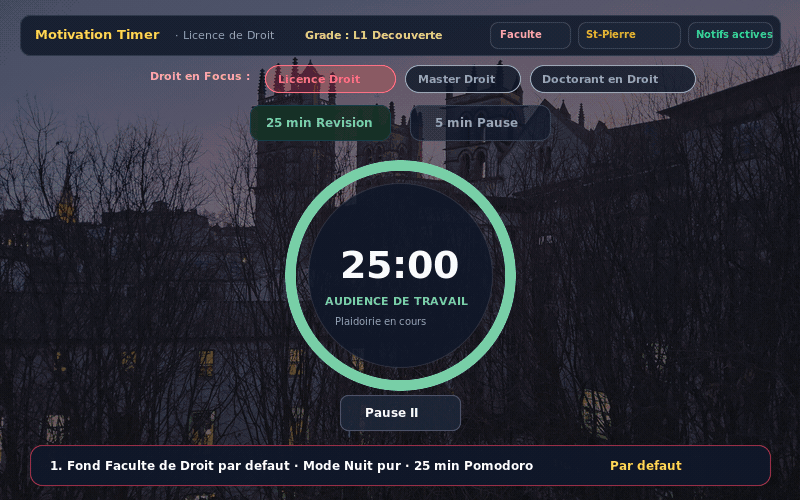

# ⚖️ Motivation Timer · Licence de Droit

> *« Par ces motifs, la flemme est déboutée et la session de révision validée avec mention très honorable. »*

Bienvenue sur le **Motivation Timer**, une application web épurée aux couleurs pastel conçue sur mesure pour accompagner les étudiants en **Licence de Droit** (L1, L2, L3) et en Master dans leurs révisions quotidiennes, fiches d'arrêt, cas pratiques et préparations de TD.

---

## 🎬 Démonstration animée (« How to App »)



---

## 🏛️ Comment ça fonctionne ?

L'application repose sur le principe de la méthode Pomodoro rythmée par l'univers et l'humour juridique des facultés de droit françaises :

### 1. 🌿 Lancer une session de révision (25 minutes)
- Choisissez votre niveau dans la barre **« ⚖️ Droit en Focus : »** :
  - 🥇 *Licence Droit*
  - 🎓 *Master Droit*
  - 📜 *Doctorant en Droit*
- Cliquez sur **« 25 min Révision »** pour ouvrir l'audience de travail.
- Une palette apaisante **vert sauge pastel** (`#74A790`) favorise une concentration sereine et sans distraction.
- L'anneau circulaire dynamique et l'onglet de votre navigateur indiquent le temps restant en direct `(24:48) Révision · Droit`.

### 2. ⏳ Animation de pulsation subtile (Dernières 60 secondes)
- Dès que le minuteur entre dans les **60 dernières secondes** d'un cycle de révision ou de pause :
  - **Pulsation délicate du cercle** : l'anneau de progression et le halo lumineux s'animent d'un effet respirant subtil (`@keyframes timer-final-minute-pulse` et `.animate-stroke-pulse`) pour signaler sans agressivité l'approche de la fin de l'audience.
  - **Badge d'alerte discret** : affichage du repère *« Sprint final · 60s »* et du statut *« Délibéré imminent ! »* au centre du cadran.
  - **Transition de couleur douce** : l'anneau adopte un ton rose corail chaleureux pour focaliser les dernières secondes d'effort.

### 3. 🔔 Cloche de la Cathédrale Saint-Pierre & Sons de fin de cycle
- À la fin des 25 minutes de révision (ou de la pause de 5 minutes) :
  - **Son par défaut** : La majestueuse cloche de la **Cathédrale Saint-Pierre** (note profonde, résonance de bronze et acoustique solennelle pour clore la session).
  - **Menu Audio intégré** : Sélectionnez ou prévisualisez d'un clic votre ambiance sonore préférée :
    - 🔔 *Cathédrale Saint-Pierre* (Sonnerie de cloche solennelle par défaut)
    - ⚖️ *Marteau de juge* (Double frappe d'audience au Palais de Justice)
    - 🪷 *Carillon zen* (Harmoniques douces pour révisions nocturnes)
  - **Célébration** : Pluie de confettis aux teintes pastel.
  - **Message d'encouragement drôle** tiré de la jurisprudence étudiante : citations revisitant l'article 1240 du Code civil, l'arrêt Blanco de 1873, Portalis, les fiches d'arrêt le dimanche à 23h59, ou le sacro-saint plan binaire en deux parties (I-A, I-B, II-A, II-B).
  - Bouton pour copier la citation en un clic et la partager sur vos groupes de TD.

### 4. 📢 Notifications du Navigateur (Web Notifications API)
- **Alerte même en arrière-plan** : Activez d'un clic les notifications du bureau via le bouton **« Alerte bureau »** de la barre supérieure.
- Lorsque l'application est réduite, en arrière-plan ou que vous travaillez sur un cours PDF / traitement de texte, le navigateur affiche une **notification système native** au moment exact où la session de révision ou la pause s'achève.
- Un clic sur la notification replace immédiatement l'onglet au premier plan.
- **Respect absolu de la vie privée** : Déclenché 100 % localement via l'API HTML5 standard du navigateur, sans aucun serveur push distant.

### 5. ☕ Prendre une pause réglementaire (5 minutes)
- Cliquez sur **« 5 min Pause »** pour suspendre la séance.
- L'interface bascule dans un ton doux **pêche / terracotta pastel** (`#DE8672`).
- À la fin des 5 minutes, la cloche retentit pour vous rappeler que la suspension d'audience est levée et qu'il est temps de regagner les débats.

### 6. 🌙 Mode Nuit permanent, Plein Écran & Fonds d'Écran
- **Mode Nuit exclusif & permanent** : Conçu pour offrir un confort visuel optimal sans fatigue oculaire (`#0B0F17`) avec contrastes délicats et typographies douces.
- **Mode Plein Écran** : Bouton dédié dans la barre supérieure pour masquer l'interface du navigateur et vous immerger dans une bulle de concentration totale sans distraction (sortie via le bouton ou la touche Échap).
- **Choix du Fond d'Écran & Changement en 1 clic** :
  - **Clic direct** sur le bouton de fond d'écran : bascule immédiatement vers le fond d'écran suivant !
  - **Flèche déroulante (▼)** : ouvre la galerie visuelle pour choisir précisément parmi les 5 ambiances ou régler l'intensité :
    1. 💻 **LegalTech & Zen Code** : Sanctuaire nocturne mêlant droit et programmation (Thémis sculptée aux balances dorées, écran de code émeraude, bibliothèque de codes juridiques, bougie chaleureuse et vue crépusculaire).
    2. 🤍 **Cœur de Sélénite** : Cœur de cristal lumineux, halo doré de bougie, lueur scintillante et base de quartz en plein écran harmonisé pour un calme d'étude absolu.
    3. 🏛️ **Faculté de Droit** : L'architecture historique de la faculté sous un ciel crépusculaire pastel.
    4. ☀️ **Un jour à la fois** : Amphithéâtre de Faculté de Droit baigné d'une douce lumière matinale avec siège invitant, cahier de cours ouvert et café fumant (« *L'objectif du jour : être présent et s'asseoir sur sa chaise en amphi* »).
    5. 🍃 **Minimaliste** : Canvas épuré aux douces lueurs diffuses sans illustration.
  - **Réglage d'intensité** : Choisissez entre *Discrète (40%)*, *Équilibrée (75%)* et *Immersive (95%)* avec prévisualisation immédiate et contrastes préservés.

### 7. 📜 Code de Survie, Guide « Tout en douceur » & Système de Grades
- **Guide Visuel Haute Résolution** : L'illustration motivationnelle « *Réussir ses études de Droit (tout en douceur !)* » est désormais intégrée directement dans le Code de Survie, permettant à l'étudiant de l'agrandir (`Zoom in`), de la feuilleter confortablement et de consulter les 6 piliers méthodologiques sans superposition avec le chronomètre.
- **Principes Fondamentaux** : Révisez les 5 règles clés du juriste (le dogme du plan binaire, l'immunité de l'arrêt Blanco, la magie du stabilo pastel, le 10,01 compensé).
- Suivez votre montée en grade automatique au fil des sessions :
  - 🎓 *Étudiant perdu en amphi* (L1 Découverte)
  - ✒️ *Scribe de Fiches d'Arrêt* (L2 Affûté)
  - 📖 *Exégète du Code Civil* (Adepte de Portalis)
  - ⚖️ *Plaideur Hors-Pair* (Ténor du Prétoire)
  - 🏆 *Major(e) de Promotion* (Grand Duc du Barreau)

---

## 🛡️ Contrôle de Cybersécurité & Données Personnelles (RGPD)

Ce projet GitHub a fait l'objet d'un contrôle rigoureux de cybersécurité et de conformité aux normes européennes de protection des données :

| Critère de Sécurité | Mesure Mise en Œuvre | Statut |
| :--- | :--- | :--- |
| **Architecture Local-First** | 100 % de l'exécution s'effectue dans le navigateur du client. Aucune donnée d'étude, statistique ou identifiant n'est transmis à un serveur tiers. | ✅ Conforme |
| **Stockage sécurisé** | Utilisation sécurisée de l'API standard `localStorage` encapsulée dans des blocs `try/catch` pour parer toute altération ou injection. | ✅ Sécurisé |
| **Protection contre les failles XSS** | Rendu sécurisé React (aucun usage de `dangerouslySetInnerHTML`), contrôle de typage strict TypeScript, assainissement de toutes les chaînes injectées dans le DOM. | ✅ Protégé |
| **Protection contre les attaques CSRF & Injection** | Pas d'APIs mutatives non authentifiées, pas d'exécution de code dynamique (`eval`), ressources hébergées localement. | ✅ Protégé |
| **Respect de la vie privée (RGPD & CNIL)** | Zéro traqueur d'audience, zéro cookie publicitaire, zéro télémétrie invasive. L'étudiant conserve le contrôle souverain de ses données. | ✅ 100 % Conforme |
| **Web Notifications API** | Déclenchement conditionné à l'autorisation explicite de l'utilisateur (`Notification.requestPermission()`). Pas de serveur push tiers. | ✅ Conforme |
| **Politique de Sécurité GitHub** | Présence d'un fichier `SECURITY.md` formalisant la procédure de divulgation responsable de vulnérabilités (*Responsible Disclosure*). | ✅ Documenté |

---

## ⚖️ Propriété Intellectuelle & Droit d'Auteur

Le statut juridique du projet sur GitHub est strictement encadré par le droit d'auteur français (Code de la propriété intellectuelle - CPI) et les standards du logiciel libre :

1. **Licence du Code Source (Apache 2.0)** :
   - Le code source original de l'application est publié sous licence **Apache 2.0** (voir fichier `LICENSE`).
   - Cette licence permet la consultation, la duplication (fork), la modification et la réutilisation du code, y compris pour des projets dérivés, sous réserve de conserver les mentions de copyright et de paternité de l'auteur original.

2. **Citations Législatives, Jurisprudentielles & Doctrinales** :
   - Les extraits de textes juridiques officiels (Code civil, Code pénal, arrêts du Conseil d'État et de la Cour de cassation, citations de Portalis ou de grands jurisconsultes) sont insusceptibles d'appropriation privative en vertu de la doctrine et de l'article **L. 122-5 du Code de la propriété intellectuelle (CPI)** régissant les actes officiels et les courtes citations à des fins pédagogiques et critiques.

3. **Créations Visuelles & Fonds d'Écran** :
   - Les arrière-plans artistiques et illustrations intégrés au projet sont exploités dans un cadre d'accompagnement éducatif et de motivation des étudiants en droit.
   - Les droits moraux (droit à la paternité et respect de l'œuvre) sont pleinement réservés à leurs auteurs respectifs.

4. **Patrimoine Acoustique (Cloches & Effets sonores)** :
   - L'enregistrement et les harmoniques de la cloche de cathédrale (Bourdon) appartiennent au patrimoine acoustique et culturel, libres de réutilisation dans un cadre d'application pédagogique sans exploitation commerciale payante.

---

## 🛠️ Stack Technique

- **Framework** : [React 19](https://react.dev/) + [TypeScript](https://www.typescriptlang.org/)
- **Outil de build** : [Vite](https://vitejs.dev/)
- **Styles & Design** : [Tailwind CSS v4](https://tailwindcss.com/) (Palette pastel douce & Mode sombre natif `@custom-variant dark`)
- **Icônes** : [Lucide React](https://lucide.dev/)
- **Animations & Confettis** : [canvas-confetti](https://www.npmjs.com/package/canvas-confetti)
- **API Navigateur** : Web Notifications API (HTML5) & Fullscreen API
- **Audio immersif** : Cloche de cathédrale solennelle avec double architecture (fichier audio haute fidélité + moteur de synthèse Web Audio acoustique sans latence)

---

## 🚀 Installation et Lancement Local

### Prérequis
- Node.js (v18 ou supérieur)
- npm ou bun

### Étapes

1. **Cloner le dépôt :**
   ```bash
   git clone https://github.com/votre-compte/motivation-timer-droit.git
   cd motivation-timer-droit
   ```

2. **Installer les dépendances :**
   ```bash
   npm install
   ```

3. **Lancer le serveur de développement :**
   ```bash
   npm run dev
   ```
   L'application s'ouvre sur `http://localhost:3000`.

4. **Compiler pour la production :**
   ```bash
   npm run build
   ```

---

## ⚖️ Mentions légales & humour universitaire

Cette application est réalisée bénévolement pour soutenir les étudiants en Droit. Tout rapprochement avec une quelconque obligation de réussir du premier coup relève de l'application stricte de la force obligatoire de votre motivation (art. 1103 C. civ.).
